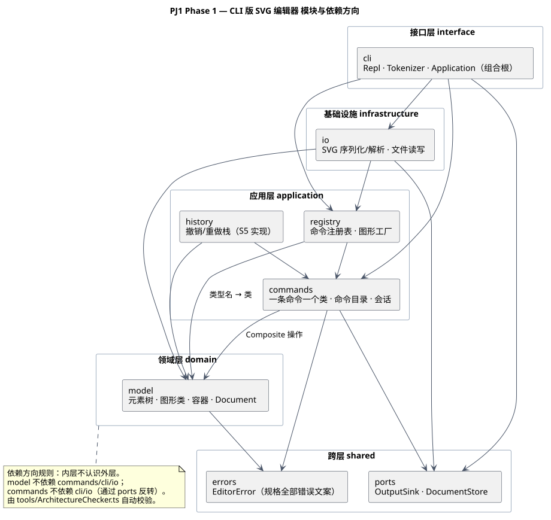

# PJ1 Phase 1 —— CLI 版 SVG 编辑器：项目文档

> 需求编号（`R-*`）与决策编号（`D-*`）见 [`../docs/plan.md`](../docs/plan.md)（需求矩阵、决策记录、修订记录）。
> 本文件按课程要求分四节；**架构方案**已完成，其余三节在实现收尾时填写。

---

## 架构方案

### 0. 一句话概括

**分层 + 端口适配器 + Command 模式**：领域模型（元素树）完全不认识文件、XML 和命令行；
每一条用户命令都是一个对象；"按名字分派"只存在两处，并且被显式圈出来当作待重构点。

### 1. 模块划分

#### 1.1 组件图



> PlantUML 源：[`../docs/architecture.puml`](../docs/architecture.puml)；重新渲染：`npm run diagram`
> （开发机没有 Java，脚本通过 PlantUML 官方服务渲染并保存为 `doc/architecture.svg`；
> 用本地 `plantuml.jar` 也能得到同样结果）。

#### 1.2 每个模块的职责

| 目录 | 层 | 职责 | 关键类型 | 允许依赖 |
|---|---|---|---|---|
| `src/errors/` | 跨层 | 用户可见错误：规格 §4.2 的 11 条 + 补充的 12 条全部收敛为工厂方法，文案只有一处定义 | `EditorError` | 无 |
| `src/ports/` | 跨层 | 应用层依赖的**接口**（端口）：往哪打印、怎么存取文档 | `OutputSink`、`DocumentStore`、`LoadedDocument` | `model`（仅类型引用） |
| `src/model/` | 领域 | 元素树与图形：`Element`/`Shape`/5 个叶子/`Container`/`Group`/`ForeignElement`/`Document`，外加数值格式与样式属性表。**纯内存，无 IO、无 CLI** | `Element`、`Rect`…、`Document` | `model`、`errors` |
| `src/io/` | 基础设施 | SVG 序列化与解析、文件读写。**唯一**接触 XML 库（`fast-xml-parser`）与 `node:fs` 的地方 | `SvgWriter`、`SvgReader`、`XmlParser`、`FileStore`、`SvgDocumentStore` | `io`、`model`、`errors`、`ports`、`factory` |
| `src/commands/` | 应用 | 命令层：一条命令一个类（Command 模式）、命令目录（help 的数据源）、会话（当前文档 / 按 id 查找）、命令输出格式（`TreeFormatter`/`ShowFormatter`） | `Command`、`CommandCatalog`、`EditorSession`、`*Command` | `commands`、`model`、`errors`、`ports`、`factory` |
| `src/history/` | 应用 | 撤销/重做栈与 io 锁（**S5 实现**） | `UndoStack` | `history`、`commands`、`model`、`errors` |
| `src/registry/` | 应用 | **第一处按名分派**：命令名 → 实现 | `CommandRegistry` | `registry`、`commands`、`model`、`errors` |
| `src/factory/` | 应用 | **第二处按名分派**：类型名/标签名 → 类（`create` 与读文件共用） | `ShapeFactory` | `factory`、`model`、`errors` |
| `src/cli/` | 接口 | 进程边界：REPL、分词、终端适配器、组合根 `Application`。不知道图形语义，只负责"读一行 → 执行 → 打印" | `Repl`、`Tokenizer`、`Application` | 全部 |

> 前端（`cli`）→ 应用（`commands`/`history`/`registry`/`factory`）→ 领域（`model`）是"向内收缩"的三层，
> `io` 是挂在旁边的适配器，`ports` 与 `errors` 是两个被各方共用的窄接口。
>
> `factory/` 单独成模块（S4 从 `registry/` 拆出）：`create` 命令与读文件都要用它，
> 而 `registry/` 依赖 `commands/`（它保存命令实例），若把工厂留在 `registry/`，
> 命令层引用工厂就会形成 `commands ↔ registry` 的环。拆成只依赖 `model`/`errors` 的独立模块后，依赖图仍然无环。

#### 1.3 为什么没有 `src/geometry/` 模块

原计划里有一个 `src/geometry/` 专门放坐标运算。S2 实现时取消了，理由是：
`move`/`scale` 的算术**天然属于每个图形自己**（`rect` 改 `x/y/w/h`，`circle` 改 `cx/cy/r`，`line` 改四个端点）。
把它抽成独立模块，要么变成一堆 `switch (类型)`、要么变成一堆只做转发的方法——
前者正是 spec §2.1 明令禁止的写法，后者只是多一层间接。
运算集中在 `Shape.shift/multiply` 里，子类只声明"我有哪些几何属性"。已记入 [`../docs/plan.md`](../docs/plan.md) 第 8 节修订记录。

### 2. 设计模式的选择

#### 2.1 Command 模式（规格强制，本项目的骨架）

- **接口**：`Command.execute(args, context): void`，一条命令一个类、一个文件（`src/commands/CreateCommand.ts`）。
- **落地方式**：`CommandRegistry` 保存"命令名 → 实例"，REPL 只做 `lookup(name)` 然后调用；
  **`Repl.ts` 里没有任何一行 `switch` 或 `if (name === 'create')`**。
- **为什么值得**（不只是为了合规）：
  1. **可逆性有了落脚点**：一条命令就是一个原子编辑单元，S5 的撤销栈只需要把命令对象压栈，
     `group g1 r1 c1 t1` 这种复合操作天然是一个单元；
  2. **扩展点固定**：新增命令 = 新增一个类 + 注册，REPL、`help`、撤销栈都不用改；
  3. **`help` 与实现共用一份数据**：`CommandCatalog`（19 条）同时驱动 `help` 输出与用法错误提示，
     不会出现"help 说有、实际没有"的漂移。
- **现状**：S3 结束时已落地 5 条（`help`/`init`/`canvas`/`read`/`save`），S4 补齐编辑类。

#### 2.2 Composite（规格强制：容器与叶子统一操作）

`Element` 声明 `translate`/`scaleBy`/`setAttribute`，`Container` 用**递归**实现，
于是 `move node2 0 100` 对 `<g>` 和对 `<rect>` 是同一句话——组里的矩形与文字自动跟随。
证据：`tests/model/Container.test.ts`（移动/缩放容器后子节点数值随之改变）。

#### 2.3 Factory（图形工厂 = 规格允许的第二处分派）

`ShapeFactory`（`src/factory/`）是"类型名 → 类"的唯一映射，它同时服务两条路：
读文件时的**标签名 → 类**（`<rect>` → `Rect`，未知标签 → `ForeignElement`），
`create` 命令时的**类型名 → 类**（`create rect …`，含每种类型的参数校验）。
新增一种图形只需要动这一个文件，`switch` 的影响面被锁死在一处。

它有自己的模块（S4 从 `registry/` 拆出）而不是塞进命令层或读取器，原因见 §1.2 末尾的说明：
它是被 `commands` 与 `io` **双向共用**的窄组件，独立成模块才能让依赖图保持无环。

#### 2.4 端口与适配器（六边形）

`ports/` 只放接口，`cli/`、`io/` 提供实现，`Application` 是组合根。

不是为了"看起来高级"：S1 时命令层需要打印结果，如果直接引用 `cli/OutputSink`，
依赖方向就会变成 `commands → cli`，而 `cli/main` 又必须 `import commands`，形成双向依赖。
把接口搬到 `ports/` 之后方向固定为 `cli → commands → ports`，`commands → cli` 这条边被**消灭**而不是被允许
（详见 [`ai-log.md`](ai-log.md)）。

#### 2.5 Memento（S5 规划）

撤销记录"改之前的值"（旧坐标、旧属性、被删除子树及其父节点与位置），而不是记录"反向命令"。
对 `group`（多个元素跨父节点移动）、`delete`（整棵子树）这类操作，存值比写反向逻辑简单得多，也更容易验证。

#### 2.6 Template Method

`Shape.setAttribute`/`detailLines` 定义了"校验白名单 → 写值"的骨架，
子类只声明 `geometryNames(): readonly string[]`。删除重复代码的同时，
让"给 rect 设 width、给 circle 设 r"这类差异只出现在数据里。

#### 2.7 刻意**没有**用的模式

| 模式 | 为什么不用 |
|---|---|
| Visitor | `tree`/`show` 的格式化已经由元素自己的 `summary()`/`detailLines()` 多态承担；只有将来要同时支持 JSON/HTML 等多种输出格式时，引入 Visitor 才划算 |
| State | "io 命令后禁止 undo"只是一个布尔状态，用状态机会把 3 行代码变成 3 个类 |
| Singleton | 全部依赖注入，没有全局实例；测试可以直接 `new Application()` 得到一个干净会话 |
| 抽象工厂 / DI 容器 | 只有 9 个模块、依赖关系是一棵浅树，手写组合根（`Application`）比引入容器更可读 |

### 3. 依赖方向规则

#### 3.1 规则表

| 模块 | 允许依赖 | 理由 |
|---|---|---|
| `errors` | — | 只是错误类型，谁都可以用，它不能反过来用别人 |
| `ports` | `model`（仅类型） | 端口签名要用到 `Document`，但不能用 `io` 的实现 |
| `model` | `model`、`errors` | 领域模型必须能被单独理解：不许 import 命令、CLI、XML、文件系统 |
| `factory` | `factory`、`model`、`errors` | 只负责"名字 → 类"，不碰 IO 也不碰命令；正因为够窄，才能被两边共用 |
| `io` | `io`、`model`、`errors`、`ports`、`factory` | 读写要把 XML 变成模型对象，所以要用图形工厂；但**反过来不允许**：`factory` 不依赖 `io` |
| `commands` | `commands`、`model`、`errors`、`ports`、`factory` | 命令用模型做修改、用端口输出与存盘、用工厂造新元素；**不许** import `cli`（外层）、**不许** import `io`（细节被端口挡住） |
| `history` | `history`、`commands`、`model`、`errors` | 撤销栈里存的是命令对象，所以要认识命令 |
| `registry` | `registry`、`commands`、`model`、`errors` | 注册表要持有命令实例；它依赖命令，所以命令层不能反过来依赖它 |
| `cli` | 全部 | 它是组合根，只在这里把实现装配起来 |

一句话原则：**依赖只能指向更内层或更稳定的那一侧；内层不知道外层存在。**

#### 3.2 执行手段（不是靠自觉）

`tools/ArchitectureChecker.ts` 扫描 `src/**/*.ts` 的全部相对导入，
按上表判定；违反即输出违规清单并以非零码退出：

```
$ npm run arch:check
dependency rules (module -> may import)
  errors    -> (nothing)
  ports     -> model
  model     -> model, errors
  factory   -> factory, model, errors
  commands  -> commands, model, errors, ports, factory
  …
scanned 46 files under src/
no dependency violations
```

它被串进 `npm run check`（= 类型检查 + 测试 + 架构检查），和测试一样是**会失败的**。
另外脚本本身也被测过：`tests/tools/ArchitectureChecker.test.ts` 用一份**故意违规**的 fixture
（`model` 里 import 了 `cli`）断言它确实能抓到问题——否则"永远输出 ok"的检查脚本毫无价值。
**模块表里没有出现的模块会被直接报错**，这样新增模块必须显式声明依赖（并同步写进本文件）。

当前状态：**46 个源文件、0 违规**。

### 4. 变化点假设

按"最可能发生变化"的顺序排列，并说明我**为它留了什么**，或者**为什么决定不留**。

| # | 变化点 | 我留了什么 | 或者为什么决定不留 |
|---|---|---|---|
| 1 | **新增图形类型**（下一阶段的 `box` 插件、`path`/`polygon` 等） | `ShapeFactory` 是唯一的"类型 → 类"映射，加类型 = 加一个类 + 一处注册；未知标签已经能作为 `ForeignElement` 无损保留，所以"先支持读取、再支持编辑"这条路是通的 | 没有做插件加载器：本阶段规格明确不要求（R-SCOPE1），提前做会把 20 行的工厂变成一套不成熟的注册框架 |
| 2 | **命令集合扩张**（`copy`/`align`/`rotate`…） | `Command` 接口 + `CommandRegistry` + `CommandCatalog`；新命令不改 REPL、不改 `help` 逻辑、不改撤销栈 | 没有做统一的参数 schema 校验框架：参数校验留在各命令内部，错误文案才能贴着规格写（`error: scale factor must be positive` 这类文案没有通用化的必要） |
| 3 | **定位方式变化**（id → `/canvas/g1/rect[2]` 式路径选择器，规格 §2 提到过这个备选） | 寻址只有两个入口：`EditorSession.requireDocument()` 与 `Document.find(id)`；换选择器只需换这两个实现，命令层不受影响 | 没有现在就抽出 `AddressResolver` 接口：只有一个实现时，抽象会变成空壳（YAGNI）；等真的出现第二种寻址方式再抽 |
| 4 | **序列化细节变化**（缩进、属性顺序、是否保留注释、命名空间） | `SvgWriter` 单点；XML 库被 `XmlParser` 隔离（D1），换库只改一个文件；未知属性/未知元素原样保留（D8），所以"读出再写回"已经是安全的 | 没有保留 XML 注释：`fast-xml-parser` 的注释处理会显著复杂化读取器，而本阶段没有任何要求依赖注释 |
| 5 | **变换语义变化**（改用 `transform` 属性、支持旋转与斜切） | `move`/`scale` 目前是坐标改写，运算集中在 `Shape.shift/multiply`；要换成矩阵变换，只需替换这两个方法，调用方不变 | 没有预留旋转/斜切、也没有做矩阵类：规格只要求等比缩放，提前抽象矩阵会引入大量未被验证的代码 |
| 6 | **撤销策略变化**（命令反向 vs 整文档快照） | `history` 模块独立于命令，接口是"push/pop 单元"；S5 用 Memento 记旧值，将来换快照只改这一层 | 没有做整文档快照：当前文档规模小，但快照会掩盖命令层设计问题，也不利于"一条命令一个单元"的语义 |
| 7 | **承载形式变化**（从 CLI 到 TUI/GUI） | 输出通过 `ports/OutputSink` 端口，`Application` 已封装装配；核心不依赖终端 | 没有为 GUI 预留视图模型（VM/绑定）：本阶段目标就是 CLI，那层抽象现在只会是空壳 |
| 8 | **数值与精度策略**（是否需要保留原始字符串、支持单位） | `NumberFormat` 单点控制精度（6 位小数，D15）；文档的 `width`/`height`/`viewBox` 已能原样回写（D17/D22） | 没有做完整的单位系统（`px`/`em`/`%` 的换算）：没有视口信息时无法正确换算，宁可原样保留字符串 |

---

## 过程记录

> 原始素材见 [`ai-log.md`](ai-log.md)（随开发实时记录的协作日志，含每次真实报错与修正）。
> 本节在实现收尾时从中提炼代表性条目（预计 5–6 条：设计取舍、被测试/工具抓到的真实缺陷、以及"AI 给的方案被否决"的案例）。

（待补）

## 一致性自查

（实现收尾时填写：实际目录 vs 本文档的模块表；依赖方向规则的抽样检查结果——直接引用 `npm run arch:check` 的输出）

## 质量保证手段

（实现收尾时填写：功能完整性如何确认（需求矩阵逐条对照 + spec 会话回放）、对代码质量有信心的依据（110+ 用例、类型检查、架构检查、渲染核对））
